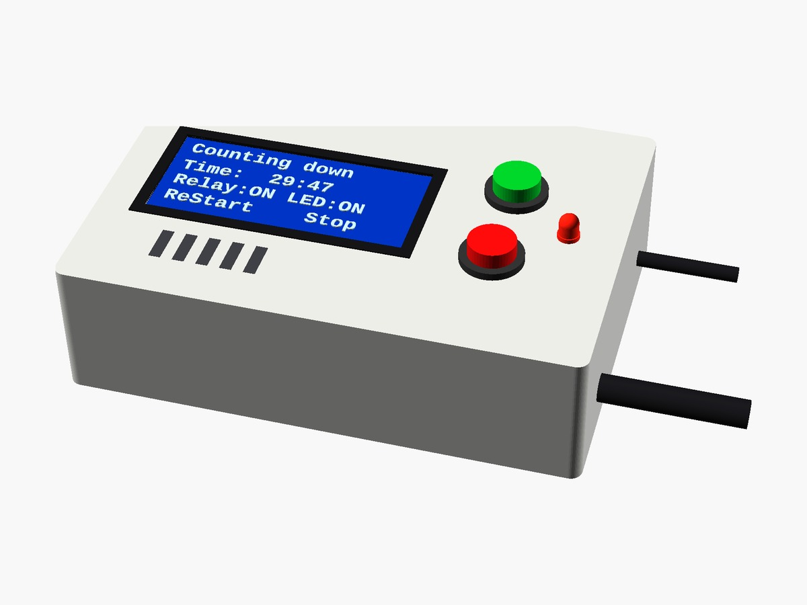

# Arduino countdown timer with 16×4 LCD, relay and buzzer

> 📖 **Full article with wiring diagram, photos and step-by-step explanations (in Italian):**  
> **[Arduino countdown timer with 16×4 LCD, relay and buzzer – www.emgi.it](https://www.emgi.it/2026/04/03/contatore-alla-rovescia-arduino-con-lcd-16x4-rele-e-buzzer/)**
>
> More electronics, Arduino, ESP32, Home Assistant and 3D printing projects at **[www.emgi.it](https://www.emgi.it)**

This project shows how to build a **30-minute countdown timer with Arduino**, with a **16×4 I2C LCD**, an **output relay**, a **status LED** and a **passive buzzer that plays a soft final melody**.

It is designed for practical use on a workbench (e.g. to switch off a soldering iron), but it is easy to adapt to other uses.

## Main features

- Automatic **30-minute** countdown
- **START / Restart** button
- **Immediate STOP** button
- **Relay on** while counting down
- **Steady LED + accelerating blink** at the end
- **Soft passive buzzer** (no distortion), melody 30 seconds before the end
- **16×4 LCD with dynamic messages**
- No display flicker (optimised refresh)

## Parts list

- Arduino UNO or Nano
- 16×4 LCD with I2C interface
- 2 push buttons
- 1 LED
- 220 Ω resistor
- Passive buzzer
- 5 V relay module
- Stable 5 V power supply

## Wiring

Board: **Arduino UNO or Nano**. Pins checked against the sketch (`startBtn = 8`, `zeroBtn = 9`, `relayPin = 10`, `buzzer = 11`, `ledPin = 12`).

| Component | Component pin | Arduino |
|---|---|---|
| 16×4 I2C LCD (address `0x27`) | VCC | 5V |
| | GND | GND |
| | SDA | A4 |
| | SCL | A5 |
| START button | one leg | D8 |
| | other leg | GND |
| STOP button | one leg | D9 |
| | other leg | GND |
| 5 V relay module | IN | D10 |
| | VCC | 5V |
| | GND | GND |
| **Passive** buzzer | + | D11 |
| | − | GND |
| Status LED | anode (long leg) | D12 through a **220 Ω** resistor |
| | cathode | GND |

- The buttons need no resistors: the sketch uses the internal pull-up (`INPUT_PULLUP`), so pressed = connected to GND.
- If your LCD uses address `0x3F` instead of `0x27`, change it in the line `LiquidCrystal_I2C lcd(0x27, 16, 4);`.
- The load switched by the relay (e.g. a 230 V soldering iron) goes on the module's **COM/NO** contacts: work with the mains disconnected and insulate the contacts well.
- Power: a stable 5 V supply; consumption rises when the relay is on, so use a supply rated at least 1 A.

## Repository contents

| Path | Description |
|---|---|
| `Soldering_Countdown_Timer/Soldering_Countdown_Timer.ino` | Arduino sketch |
| `images/` | Photos and images |

## How to use it

1. Open [`Soldering_Countdown_Timer.ino`](Soldering_Countdown_Timer) in the Arduino IDE and upload it to an Arduino UNO or Nano.
2. Connections: I2C LCD on A4/A5, START D8, STOP D9, relay D10, buzzer D11, LED D12.

Wiring diagram, details and troubleshooting: **[article on www.emgi.it](https://www.emgi.it/2026/04/03/contatore-alla-rovescia-arduino-con-lcd-16x4-rele-e-buzzer/)** (in Italian).

## License

- Code and configuration: [MIT](LICENSE)
- 3D models, diagrams and images: [CC BY-SA 4.0](https://creativecommons.org/licenses/by-sa/4.0/)

---

**Author:** Massimiliano Sandrin – **[eMGi.it](https://www.emgi.it)** · Questions and comments below the [article on the website](https://www.emgi.it/2026/04/03/contatore-alla-rovescia-arduino-con-lcd-16x4-rele-e-buzzer/).
