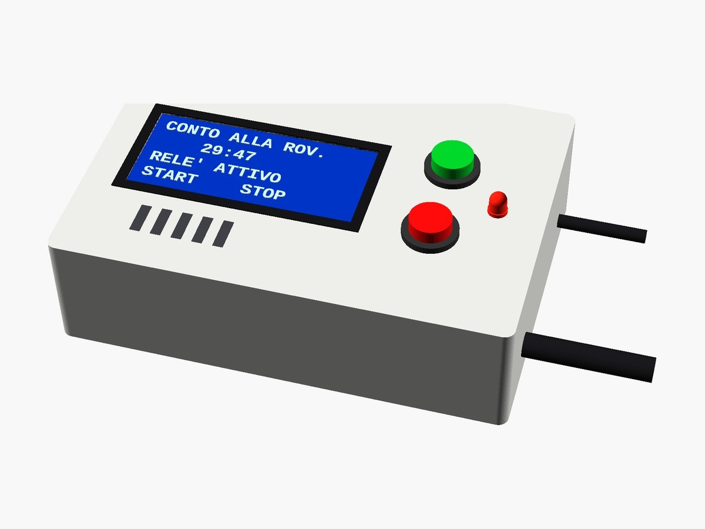

# Contatore alla rovescia Arduino con LCD 16×4, relè e buzzer

> 📖 **Articolo completo con schema, foto e spiegazioni passo passo:**  
> **[Contatore alla rovescia Arduino con LCD 16×4, relè e buzzer – www.emgi.it](https://www.emgi.it/2026/04/03/contatore-alla-rovescia-arduino-con-lcd-16x4-rele-e-buzzer/)**
>
> Altri progetti di elettronica, Arduino, ESP32, Home Assistant e stampa 3D su **[www.emgi.it](https://www.emgi.it)**

Questo progetto mostra come realizzare un **contatore alla rovescia da 30 minuti con Arduino**, completo di **display LCD 16×4 I2C**, **relè di uscita**, **LED di stato** e **buzzer passivo con melodia finale morbida**.

È pensato per utilizzo pratico su banco di lavoro (es. saldatore), ma adattabile facilmente ad altri contesti.

## Caratteristiche principali

- Countdown automatico da **30 minuti**
- Pulsante **START / ReStart**
- Pulsante **STOP immediato**
- **Relè attivo** durante il conto
- **LED fisso + lampeggio accelerato finale**
- **Buzzer passivo soft (no distorsione)**
- Display **LCD 16×4 con messaggi dinamici**
- Interfaccia completamente in italiano
- Nessuno sfarfallio del display (refresh ottimizzato)

## Componenti necessari

- Arduino UNO o Nano
- Display LCD 16×4 con interfaccia I2C
- 2 pulsanti
- 1 LED
- Resistenza 220Ω
- Buzzer passivo
- Modulo relè 5V
- Alimentazione 5V stabile

## Collegamenti elettrici

Scheda: **Arduino UNO o Nano**. Pin verificati sullo sketch (`startBtn = 8`, `zeroBtn = 9`, `relayPin = 10`, `buzzer = 11`, `ledPin = 12`).

| Componente | Pin componente | Arduino |
|---|---|---|
| LCD 16×4 I2C (indirizzo `0x27`) | VCC | 5V |
| | GND | GND |
| | SDA | A4 |
| | SCL | A5 |
| Pulsante START | un capo | D8 |
| | altro capo | GND |
| Pulsante STOP | un capo | D9 |
| | altro capo | GND |
| Modulo relè 5 V | IN | D10 |
| | VCC | 5V |
| | GND | GND |
| Buzzer **passivo** | + | D11 |
| | − | GND |
| LED di stato | anodo (gamba lunga) | D12 tramite resistenza **220 Ω** |
| | catodo | GND |

- I pulsanti non hanno bisogno di resistenze: lo sketch usa il pull-up interno (`INPUT_PULLUP`), quindi premuto = collegato a GND.
- Se il tuo LCD ha indirizzo `0x3F` invece di `0x27`, cambialo nella riga `LiquidCrystal_I2C lcd(0x27, 16, 4);`.
- Il carico comandato dal relè (es. saldatore a 230 V) va sui contatti **COM/NO** del modulo: lavora con la rete scollegata e isola bene i contatti.
- Alimentazione: 5 V stabili; con il relè attivo il consumo sale, usa un alimentatore da almeno 1 A.

## Contenuto del repository

| Percorso | Descrizione |
|---|---|
| `Contatore_alla_Rovescia_per_Saldatore/Contatore_alla_Rovescia_per_Saldatore.ino` | Sketch Arduino |
| `immagini/` | Foto e immagini dell'articolo |

## Come si usa

1. Apri [`Contatore_alla_Rovescia_per_Saldatore.ino`](Contatore_alla_Rovescia_per_Saldatore) con Arduino IDE e carica su Arduino UNO o Nano.
2. Collegamenti: LCD I2C su A4/A5, START D8, STOP D9, relè D10, buzzer D11, LED D12.

Schema dei collegamenti, dettagli e risoluzione dei problemi: **[articolo su www.emgi.it](https://www.emgi.it/2026/04/03/contatore-alla-rovescia-arduino-con-lcd-16x4-rele-e-buzzer/)**.

## Licenza

- Codice e configurazioni: [MIT](LICENSE)
- Modelli 3D, schemi e immagini: [CC BY-SA 4.0](https://creativecommons.org/licenses/by-sa/4.0/deed.it)

---

**Autore:** Massimiliano Sandrin – **[eMGi.it](https://www.emgi.it)** · Domande e commenti sotto l'[articolo sul sito](https://www.emgi.it/2026/04/03/contatore-alla-rovescia-arduino-con-lcd-16x4-rele-e-buzzer/).
